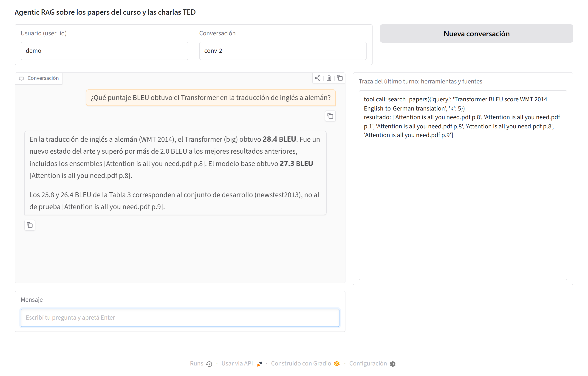
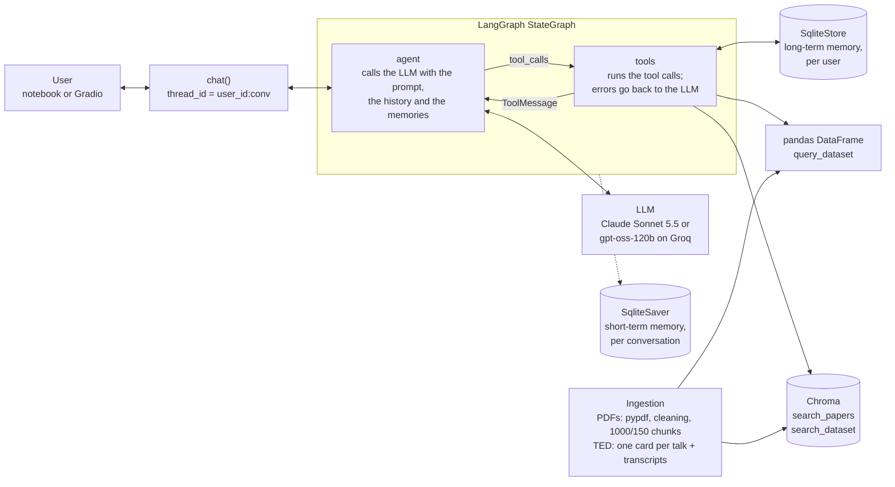

# Agentic RAG with LangGraph

A chatbot that answers questions about six long technical documents (*Attention Is All You Need*, the GPT and GPT-3 papers, *Scaling Laws for Neural Language Models*, *Subliminal Learning* and the book *Designing Data-Intensive Applications*) and about 3,921 TED talks. Every answer is grounded in what the agent retrieves and cites its source, and when nothing relevant is found the agent says so instead of guessing.

The agent loop is a LangGraph `StateGraph` written by hand: no `create_react_agent` or any other abstraction that hides the loop. It has short-term memory per conversation, long-term memory per user, and a Gradio interface.

University team project for *Taller de Tecnologías 2*, Universidad ORT Uruguay (2026). The notebook, the prompts and the agent's answers are in Spanish.



*The Gradio interface. The answer cites the page each claim comes from, and the panel on the right shows the tool call the agent made and the sources it got back.*

## Highlights

- **The agent loop is explicit.** Two nodes (`agent` and `tools`), one conditional edge, and a tools node that is a plain loop over the model's tool calls instead of LangGraph's `ToolNode`.
- **A bad tool call never breaks a turn.** Unknown tools, arguments that fail the schema, malformed JSON and exceptions inside a tool all go back to the model as an error message it can recover from. Repeated identical calls are blocked, and two independent caps stop loops.
- **"I don't know" is a measured decision.** Search tools return nothing below a relevance threshold that was calibrated on labeled questions, and the embedding model was chosen because it separates on-topic from off-topic queries.
- **Two kinds of memory.** Conversations are checkpointed in SQLite and can be paused and resumed. Facts about the user are stored separately and shared across all of that user's conversations; the agent decides what to save and what to delete.
- **Choices backed by numbers.** Embedding model, chunk size and retrieval strategy were compared with hit@5 and MRR, and a 22-question test battery is committed with its outputs.

## Stack

| Piece | Choice |
|---|---|
| Orchestration | LangGraph (`StateGraph`, conditional edges, manual tools node) |
| LLM | Claude Sonnet 5.5 via `langchain-anthropic` (final run); `openai/gpt-oss-120b` on Groq also supported |
| Embeddings | `BAAI/bge-m3`, run locally (GPU if available) |
| Vector store | Chroma, persistent, cosine similarity |
| Memory | SQLite: `SqliteSaver` checkpointer (per conversation) and `SqliteStore` (per user) |
| Dataset | [TED Ultimate Dataset](https://www.kaggle.com/datasets/miguelcorraljr/ted-ultimate-dataset) (Spanish file), CC BY-NC 4.0 |
| UI | Gradio |

## How it works



- **Agent node.** Calls the LLM with the tools bound and the user's stored memories injected into the system prompt. The prompt routes between document questions, dataset questions, general questions and small talk, and requires every answer to be grounded in retrieved context or to say there is not enough information.
- **Tools node.** A manual loop over `tool_calls`. `run_tool` never raises: whatever goes wrong becomes an error `ToolMessage`, so the model can fix its arguments or answer without that tool.
- **Loop control.** At most 4 tool rounds per user turn; after that the agent is forced to answer without tools. LangGraph's recursion limit (12 steps) is a second safety net, and a turn it interrupts does not corrupt the conversation: tool calls left unanswered are closed before the history is sent to the model again.
- **Tools.**
  - Documents: `search_papers` (semantic search, optionally limited to one document, whose name is matched loosely so "DDIA" works), `list_documents` and `paper_overview`.
  - TED: `search_dataset` (semantic search over one summary card per talk plus transcript chunks) and `query_dataset` (filter, sort and count with pandas, for questions like "how many talks about climate change after 2015?").
  - Memory: `save_memory` and `delete_memory`.
- **Hallucination control.** A search tool returns exactly `SIN RESULTADOS RELEVANTES` ("no relevant results") when no chunk reaches the relevance threshold: 0.45 cosine similarity for the documents, 0.57 and 0.60 for TED cards and transcripts. Every answer cites `[document p.N]` or `[TED: title, speaker (year)]`.
- **Ingestion.** PDFs are read page by page, repeated headers, footers and the book's alphabetical index are removed, and the text is split into 1,000-character chunks with 150 of overlap (2,331 chunks). Indexing is resumable: only the chunk ids missing from Chroma are added.
- **Sessions.** Every call carries a `user_id` and a conversation id, so several users can chat in parallel without sharing history.

## Examples

These are copied from the notebook's committed output and shortened: `[…]` marks trimmed text, and some `resultado:` lines (the sources a tool returned) are left out. Each turn starts with `[user/conversation]`, then come the tool calls, then the answer after `->`.

**A structured question goes to pandas, not to the vector store.** "How many talks about climate change were recorded after 2015?" (the topics are stored in English, so the agent translates the filter):

```text
[ted-conteo-c529232d/ted-conteo] ¿Cuántas charlas sobre cambio climático se grabaron después de 2015?
  tool call: query_dataset({'filters': [{'column': 'topics', 'op': 'contains', 'value': 'climate change'}, {'column': 'year', 'op': '>', 'value': 2015}], 'count': True})
-> Se grabaron 91 charlas sobre cambio climático después de 2015, es decir, de 2016 en adelante. […]
```

**A false premise is corrected from the source.** "Why does GPT-3 need fine-tuning for every task?"

```text
[premisa-falsa-3b0a7a2a/premisa-falsa] ¿Por qué GPT-3 necesita fine-tuning para cada tarea?
  tool call: search_papers({'query': 'GPT-3 fine-tuning not required, few-shot learning without gradient updates', 'k': 5})
-> La premisa es incorrecta: según el paper, GPT-3 no necesita fine-tuning para cada tarea.

- En todas las tareas se aplica "sin ninguna actualización de gradiente ni fine-tuning". La tarea y las demostraciones se especifican solo mediante texto [Language Models are Few-Shot Learners (GPT3).pdf p.1].
[…]
```

**Nothing found means no answer.** "Which TED talks did Lionel Messi give?"

```text
[ted-sin-datos-061d1e08/ted-sin-datos] ¿Qué charlas TED dio Lionel Messi?
  tool call: query_dataset({'filters': [{'column': 'speaker', 'op': 'contains', 'value': 'Messi'}]})
  resultado: SIN RESULTADOS RELEVANTES
-> No tengo información suficiente. Busqué charlas de un orador llamado Messi en el dataset TED (filtro: speaker contiene "Messi") y no apareció ninguna. […]
```

**Long-term memory crosses conversations.** The user introduces themselves in `conv-1`; in `conv-2`, with an empty history, the agent still knows who they are:

```text
[manu-db5f8d73/conv-1] Hola! Me llamo Manu y me interesan los transformers
  tool call: save_memory({'facts': ['Se llama Manu', 'Le interesan los transformers']})
-> ¡Hola, Manu! Un gusto. Ya tengo anotado tu nombre y que te interesan los transformers. […]

[manu-db5f8d73/conv-2] ¿Cómo me llamo y qué me interesa?
-> Te llamás Manu y te interesan los transformers.
```

**A model stuck in a loop still produces an answer.** Here the LLM is replaced by a stub that always asks for the same tool. The repeated calls are refused, and after 4 rounds the agent has to answer with what it already has:

```text
[demo/bucle-1] ¿Qué es multi-head attention?
  tool call: search_papers({'query': 'multi-head attention', 'k': 1})
  resultado: ['Attention is all you need.pdf p.5']
  tool call: search_papers({'query': 'multi-head attention', 'k': 1})
  resultado: Ya hiciste esta misma consulta en esta pregunta: usá ese resultado en lugar de repetirla.
[…]
  tope de 4 rondas de tools: el LLM responde sin tools
-> Según el paper del Transformer, la multi-head attention es un mecanismo que permite al modelo atender conjuntamente a información de distintos subespacios de representación en distintas posiciones. […]
```

## Evaluation

Section 7 of the notebook runs a 22-question test battery (routing, false premises, typos, requests to make things up, out-of-domain questions, memory across conversations), plus demos of isolated and resumed sessions and of tool-calling failures and loops. Each test cell starts with a comment stating the expected behavior, and all outputs are committed.

Section 8 measures retrieval with hit@5 and MRR on 15 questions labeled with the pages that hold the answer, plus 12 off-topic questions:

| Variant | hit@5 | MRR | Off-topic queries scoring above the worst relevant one |
|---|---|---|---|
| **bge-m3, 1000-char chunks (chosen)** | 0.933 | 0.650 | **0 / 12** |
| multilingual-e5-large, 1000-char chunks | 0.933 | 0.661 | 7 / 12 |
| bge-m3, 500-char chunks | 0.867 | 0.780 | not measured |
| bge-m3, 1500-char chunks | 0.933 | 0.789 | not measured |
| bge-m3, 1000-char chunks + MMR | 0.800 | 0.633 | not measured |

- Both embedding models retrieve equally well, but only bge-m3 scores every relevant question above every off-topic one. That gap is what makes a relevance threshold possible, and with it an honest "I don't have enough information".
- MMR hurts: each answer lives on one or two pages, and diversifying pushes those pages out of the top 5.
- 1,500-character chunks rank the right page higher but find it just as often. The LLM reads all the retrieved chunks, so finding the page matters more than its position, and with 15 questions (each one is worth 6.7 points) the difference did not justify re-indexing and recalibrating the threshold. 1,000 was kept.
- One question fails in every variant: "Which dataset was the first GPT pre-trained on?" The paper never calls itself "the first GPT", so the closest chunks come from the GPT-3 paper. In the test battery the agent recovers on its own: after the first search misses, it lists the documents, searches again inside the right paper and answers BooksCorpus with its page.

## Limitations

- The retrieval set is small (15 questions), so it can separate a good configuration from a bad one, not two good ones.
- Everything lives in one notebook, which suited the assignment. Turning it into a service would mean moving the agent into a package behind an API.
- The Gradio interface handles one request at a time, which keeps SQLite writes and the tool trace simple.
- Without a GPU only the summary card of each TED talk is indexed, so questions about what a speaker said have less to draw on.

## Running it

Developed with Python 3.11.

```bash
python -m venv .venv
.venv/bin/pip install -r requirements.txt   # Windows: .venv\Scripts\pip
cp .env.example .env                        # add CLAUDE_API_KEY or GROQ_API_KEY, and your Kaggle credentials
```

The documents are not included in this repository for copyright reasons. Download them and save them in `data/papers/` with these exact names (the citations and the evaluation set use them):

| File name | Source |
|---|---|
| `Attention is all you need.pdf` | [arXiv:1706.03762](https://arxiv.org/abs/1706.03762) |
| `GPT Improving Language Understanding by Generative Pretraining.pdf` | [OpenAI](https://cdn.openai.com/research-covers/language-unsupervised/language_understanding_paper.pdf) |
| `Language Models are Few-Shot Learners (GPT3).pdf` | [arXiv:2005.14165](https://arxiv.org/abs/2005.14165) |
| `Scaling Laws for Neural Language Models.pdf` | [arXiv:2001.08361](https://arxiv.org/abs/2001.08361) |
| `Subliminal Learning.pdf` | [arXiv:2507.14805](https://arxiv.org/abs/2507.14805) |
| `Designing Data-Intensive Applications.pdf` | Martin Kleppmann, O'Reilly ([dataintensive.net](https://dataintensive.net/)) |

Then open `agentic_rag.ipynb` with the `.venv` kernel and run all cells. The TED file is downloaded from Kaggle on the first run.

- The first run downloads bge-m3 (about 2 GB) and indexes everything into `storage/`. Later runs reuse it; delete `storage/` to re-index.
- Embeddings run on CPU unless PyTorch has CUDA. With an NVIDIA GPU, indexing the documents takes about a minute instead of about 20: install the CUDA build of the torch version pinned in `requirements.txt`.
- The TED transcripts (about 48,000 chunks) are only indexed when a GPU is available. Set `INDEX_TRANSCRIPTS=1` to force them on CPU, or `0` to skip them.
- To open the chat interface, set `ABRIR_INTERFAZ = True` in section 9. It runs at http://127.0.0.1:7860 locally, or through a public link on Colab.

## Repository layout

```
agentic_rag.ipynb        everything: ingestion, tools, agent, chat, tests, experiments and the Gradio UI
data/comparaciones.json  cached results of the experiments in section 8
data/papers/             the PDFs go here (not versioned)
docs/screenshots/        the image used in this README
CLAUDE.md                project notes for Claude Code; also the most detailed technical reference
storage/                 created at runtime: Chroma and SQLite (not versioned)
```

## Authors

- **Manuel García Conde Neira** ([GitHub](https://github.com/manuelgcn), [LinkedIn](https://www.linkedin.com/in/manuelgcn)): initial LangGraph skeleton, document ingestion and the three document tools, relevance threshold calibration, retrieval experiments, error and loop control in tool calling, first version of the Gradio interface, and the final run.
- **Ignacio Vázquez** ([@nacho-vazquez98](https://github.com/nacho-vazquez98)): agent graph, system prompt and routing, short- and long-term memory.
- **Pablo Torres** ([@PolTowers](https://github.com/PolTowers)): TED dataset ingestion and its tools, test battery and Gradio interface.

Claude Code and Codex were used as coding assistants during development.

## License

[MIT](LICENSE). The TED dataset is CC BY-NC 4.0 and the documents belong to their authors and publishers; neither is redistributed here.
